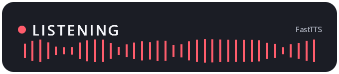

# FastTTS

**Hold Caps Lock. Talk. Let go. Your words are typed.**

FastTTS is a small, English-only dictation app for Windows. It sits in the
system tray, records while Caps Lock is held, transcribes locally with
Whisper `small.en`, and types the result into whatever window has focus.

No window to manage. No CLI. No cloud. No text-to-speech. Just push-to-talk.

## Why it is fast

- English only, so there is no language detector and no model router.
- One bundled model: Whisper `small.en` at int8, beam size 1, with VAD.
- The model loads once in the background and stays warm.
- The microphone stream stays open with a 250 ms pre-roll, so the first word
  is not lost and the first take starts instantly.
- Takes are transcribed off the keyboard thread; you can start the next take
  while the previous one is still being pasted.

## The oscilloscope HUD

A small, click-through oscilloscope sits just above the taskbar while you
dictate. It never steals focus and never appears in Alt-Tab.

- **LISTENING** with live microphone bars while Caps Lock is held.
- **TRANSCRIBING** with a scanning pulse while Whisper works.
- **ERROR** with a short message when no speech was recognized or the
  microphone/input is unavailable.

It fades away when the take is done. Set `hud = false` to turn it off.




## Requirements

- Windows 11 x64.
- Python 3.11 or newer.
- A working microphone and the default output device (for the short cues).
- The bundled English model in `models/faster-whisper-small.en` (about 464 MB).
  It ships with this checkout; nothing is downloaded at runtime.

FastTTS is self-contained on disk: the app code and the English model live in
this folder. It does not use a global model cache, and it never downloads
anything while running.

## Install and run

```powershell
cd C:\repros\FastTTS
python -m pip install -e ".[dev]"
.\start-fasttts.cmd
```

`start-fasttts.cmd` uses `pythonw`, so no console window stays open. The tray
icon appears immediately while the bundled English model loads in the
background.

The model folder is too large for Git, so it is excluded from the repository.
Keep `models/faster-whisper-small.en` beside `src/` when you copy, move or
archive FastTTS.

## Use

1. Put the cursor where the text should go.
2. **Hold Caps Lock** and speak English.
3. Release Caps Lock.

The tray icon turns red while recording and amber while transcribing. The
transcript is pasted at the caret and a space is appended. Hold-to-talk always
wins: Caps Lock never toggles the keyboard state.

- Taps shorter than 250 ms are discarded silently.
- **Pause dictation** in the tray menu lets Caps Lock behave normally again.
- **Open log** opens `%LOCALAPPDATA%\FastTTS\logs`.
- **Quit** stops the hook and closes the microphone.

Only one FastTTS instance can run at a time.

## Configuration

FastTTS runs with good defaults. To change something, create:

```text
%APPDATA%\FastTTS\config.toml
```

Every key is optional:

```toml
# Speech recognition
model = ""                  # "" = the bundled English model
device = "cpu"              # cpu, cuda or auto
compute_type = "int8"       # int8 on CPU; float16 on CUDA
cpu_threads = 0             # 0 = let CTranslate2 choose
beam_size = 1               # 1 is fastest
vad = true                  # trim silence
initial_prompt = ""         # optional spelling/name hint
cleanup = true              # remove "um", "uh" and simple stutters
model_dir = ""              # optional cache folder for an override model

# Microphone and Caps Lock
mic_device = ""             # "" = Windows default; or an index or name
min_hold_ms = 250           # shorter taps are discarded
max_record_seconds = 120
hot_mic = true              # keep the microphone open
sounds = false              # optional stop/error cues
hud = true                  # oscilloscope above the taskbar

# Text insertion
inject = "clipboard"        # clipboard (reliable) or sendinput
char_delay_ms = 10          # only used by sendinput
paste_delay_ms = 400        # wait for the target to process Ctrl+V
append_space = true
```

Environment variables override individual keys, for example
`FASTTTS_MIC_DEVICE=2` or `FASTTTS_CLEANUP=false`.

The default uses an atomic clipboard paste (`Ctrl+V`), which avoids the
key-up loss that per-character synthetic typing can cause in the new Windows 11
Notepad. The previous clipboard text is restored after the paste. Set
`inject = "sendinput"` for apps that ignore paste; FastTTS then types at 10 ms
per character and falls back to the clipboard if input is blocked.

`inject = "none"` recognises speech and writes it to the log without typing;
useful for testing a microphone without touching the focused app.

## What is intentionally not included

- Text-to-speech, Studio, voices, emotions, prosody or audio files.
- Speech-to-text for any language other than English.
- A CLI, server commands, model management commands or update checks.
- A floating window or tray animations beyond the small dictation HUD.
- Custom hotkeys, voice profiles, cloud APIs or accounts.

FastTTS is deliberately small: one microphone, one English model, one
behaviour. See [NOTICE](NOTICE) for third-party components.

## Troubleshooting

- **Nothing is inserted.** Some elevated (administrator) windows reject synthetic
  input. FastTTS tries the other insertion method automatically. If both are
  blocked, run FastTTS at the same elevation as the target app. If an app
  ignores `Ctrl+V`, set `inject = "sendinput"`.
- **"Model unavailable".** Check that `models/faster-whisper-small.en/model.bin`
  exists and is about 484 MB. FastTTS loads it from the local folder and never
  downloads it.
- **No microphone.** Windows Settings → Privacy → Microphone must allow desktop
  apps. Set `mic_device` to a specific device if the default is wrong.
- **Caps Lock hook unavailable.** Another keyboard tool may be swallowing the
  key, or the process may lack desktop-session access. Restart the tray app.
- **Wrong spelling of a name.** Put it in `initial_prompt`, for example
  `initial_prompt = "OpenCode, FastTTS, Michael"`.

## Development

```powershell
$env:PYTHONPATH = "src"
python -m ruff check src tests
python -m ruff format --check src tests
python -m pytest
```

The tests are offline. They use fake recorders, fake models and temporary
files; they never open a microphone, load Whisper or type into a window.

## License

MIT for the FastTTS code. Third-party components and the Whisper model have
their own licenses; see [NOTICE](NOTICE).
